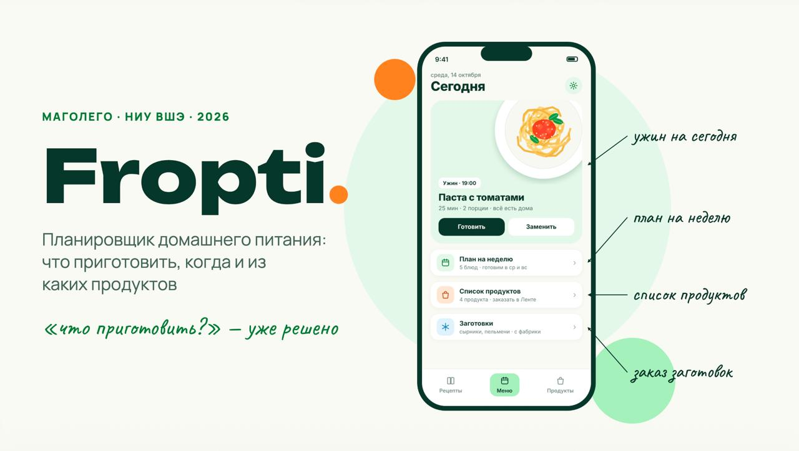
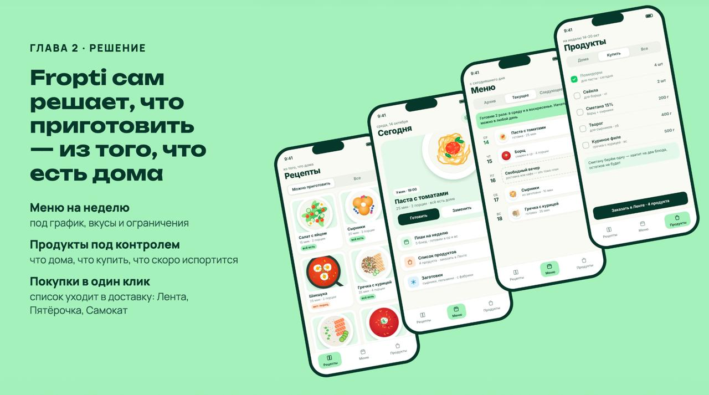
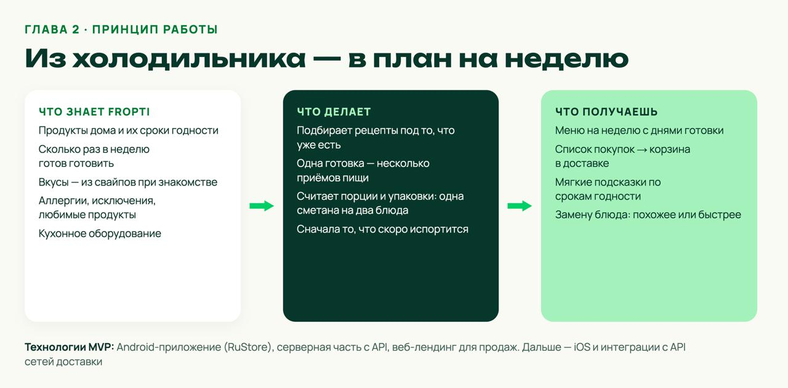

# Fropti · Video → Recipe

[](https://github.com/VictoriaPugach/recipe-video-extraction-pipeline/actions/workflows/ci.yml)

[](LICENSE)


Fropti помогает планировать домашнее питание: что приготовить, когда готовить и какие продукты купить. Модуль Video → Recipe превращает короткое видео в структурированный рецепт, который можно использовать в плане питания и списке покупок.







Это материалы питча и макеты целевого продукта, не список готовых интеграций. Описание файлов и правила добавления новых слайдов есть в [docs/slides](docs/slides/README.md).

## Задача модуля

Сервис принимает URL или загруженный файл, проверяет ограничение в 180 секунд, получает речь и текст с кадров, собирает JSON-рецепт и проверяет его по единому контракту. Python работает на сервере; мобильное приложение получает JSON по REST.

| В репозитории | Следующий этап |
| --- | --- |
| FastAPI, CLI, Docker, CI, тесты и обработка границ API | Завершить CLI/URL-проверки и приложить STT/OCR-артефакты |
| Общий пакет `fropti-core-contracts` 1.0.0 и JSON Schema | Обновить JSON и отчёт последнего Plov-запуска |
| Безопасный загрузчик URL, STT, выбор кадров, OCR, LLM и обработка ошибок | Приложить egress-журнал и записать демонстрацию по шаблону PR |

## Быстрый старт

Нужны Git и Docker Compose. Для локального запуска: Python 3.10+.

```bash
git clone https://github.com/VictoriaPugach/recipe-video-extraction-pipeline.git
cd recipe-video-extraction-pipeline
cp .env.example .env
make install
make test
make run
```

Открыть [Swagger UI](http://localhost:8000/docs). Команда `make test` проверяет JSON Schema, API, CLI, загрузку файла и общий контракт без API-ключей и внешних моделей. Это тестовый/slim-запуск, не доказательство реального распознавания. Для настоящего извлечения локально нужны `make install-ml` и LLM-настройки; полный Docker-запуск — `docker compose -f docker-compose.full.yml up --build`.

Для URL-извлечения оба Compose-файла автоматически поднимают контролируемый egress-прокси и не дают API прямого внешнего маршрута. Вне Docker задайте `EGRESS_PROXY_URL` на эквивалентный фильтрующий прокси; пустое значение запрещает URL-запуск. Сетевая проверка: `bash scripts/test_egress.sh`.

Подробные запросы, ответы и коды ошибок находятся в [API reference](docs/api_reference.md). Конфигурация и последовательность этапов находятся в [архитектуре](docs/architecture.md).

## Единый Recipe для трёх модулей

Источник истины: устанавливаемый пакет [`fropti-core-contracts`](packages/fropti-core-contracts/) версии `1.0.0`, совпадающий с upstream, и его [JSON Schema](packages/fropti-core-contracts/schemas/recipe-1.0.0.schema.json). У всех рецептов одинаковые `schema_version`, `title`, `servings`, `ingredients`, `steps` и `source`. Расширение единиц (cup, oz, lb) подготовлено как черновик 1.1.0 и ждёт согласования — [docs/drafts/](docs/drafts/contract-1.1.0-units.md).

```bash
.venv/bin/python -m fropti_core_contracts data/expected_outputs/*.json
```

| Модуль | Использование Recipe |
| --- | --- |
| Video extraction | Производит и валидирует рецепт |
| Cooking planner / batch cooking | Читает шаги и порции; граф и ресурсы задаёт собственный контракт |
| Shopping list | Читает ингредиенты и порции; остатки и агрегацию задаёт собственный контракт |

Контрактные тесты проверяют одинаковый JSON для всех трёх ролей. Правила полей, nullable-значений, единиц и версий описаны в [схеме данных](docs/data_schema.md).

## Объём MVP

Обязательный результат: локальный MP4 и URL одной согласованной платформы, ограничение длительности, STT, OCR, LLM, валидный `Recipe`, тесты без ключей и три реальных прогона с ручными эталонами.

Бонусы после MVP: дополнительные платформы, очередь, GPU-оптимизация, UI, база данных и публикация пакета. Полный пошаговый план находится в [src/TODO.md](src/TODO.md).

## План реализации MVP

Статус отмечен чекбоксами; детали — в [src/TODO.md](src/TODO.md).

1. [x] Сверить границу трёх модулей: прочитать [Recipe 1.0.0](docs/data_schema.md), запустить валидатор пакета на трёх JSON из `data/expected_outputs/` и не создавать собственную модель рецепта. Результат: примеры проходят общую схему без локальных расширений.
2. [x] Подготовить входные данные: три основных MP4 включены в ветку, заполнены [manifest](data/input_videos/manifest.json), источники и ручные эталоны; покрыты аудио, текст и их сочетание. Размещение согласовано с ревьюерами. Происхождение и оставшиеся проверки — в [provenance](data/input_videos/provenance.md) и [real-testing.md](docs/real-testing.md).
3. [x] Реализовать безопасный вход: в `src/downloader.py` определить длительность до тяжёлой обработки, отклонить файл длиннее 180 секунд и защитить загрузку URL ограничениями размера, времени, allowlist'ом хостов и контролируемым egress против SSRF. Оба вызова yt-dlp обязаны использовать egress-прокси; Compose оставляет API только во внутренней сети, а Squid разрешает DNS и отклоняет непубличные адреса на каждом запросе, включая редиректы. Проверка сети — `bash scripts/test_egress.sh`, границы — в разделе [«Безопасность»](docs/architecture.md#безопасность).
4. [x] Реализовать извлечение фактов: получить аудио и речь в `src/extractors/stt.py`, выбрать кадры в `src/extractors/frames.py`, прочитать текст в `src/extractors/ocr.py`. Закрепить используемые модели, параметры и лимиты ресурсов. Результат: пайплайн возвращает проверяемые фрагменты речи и текста с экрана.
5. [x] Собрать рецепт: в `src/llm/fusion.py` передать STT и OCR в LLM, потребовать JSON по Recipe 1.0.0, провалидировать ответ и не подставлять неизвестные числа. Затем соединить этапы в `src/pipeline.py`, API и CLI. Результат: корректный вход возвращает валидный `Recipe` либо структурированную ошибку из [API reference](docs/api_reference.md).
6. [ ] Проверить на реальных данных: тесты без ключей и `make test` выполнены; upload-результаты трёх основных видео дают 100,0%, 85,0% и 96,8% по зафиксированной метрике. Все пять сетевых egress-проверок выполнены 16.11.2026. До полной приёмки нужны фактические JSON и отчёт последнего Plov-запуска, CLI и URL-прогоны, STT/OCR-артефакты, приложенный egress-журнал и ручная проверка содержания по [real-testing.md](docs/real-testing.md).

## Проверка и сдача

- `make test`: обязательная локальная проверка; CI запускает её на `push` и Pull Request.
- [docs/evaluation.md](docs/evaluation.md): измеримая рубрика, зоны ответственности и порог совпадения с эталоном ≥80%.
- [CONTRIBUTING.md](CONTRIBUTING.md): правила ревью Виктории Пугач и Любы Новохацкой.
- [PR template](.github/pull_request_template.md): команды проверки, JSON-примеры и демонстрационный ролик до четырёх минут.
- [SECURITY.md](SECURITY.md): как сообщать об уязвимостях; секреты, cookies и персональные данные в репозиторий не добавлять.

## Навигация

| Материал | Содержание |
| --- | --- |
| [Архитектура](docs/architecture.md) | Границы модулей, целевой pipeline и безопасность |
| [Схема данных](docs/data_schema.md) | Recipe 1.0.0, JSON Schema и интеграция трёх команд |
| [API](docs/api_reference.md) | Эндпоинты и ошибки |
| [FAQ](docs/faq.md) | Запуск, конфигурация, типовые ошибки |
| [Реальные проверки](docs/real-testing.md) | План сквозной проверки на реальных видео: URL и три типа входа |
| [Данные](data/input_videos/README.md) и [примеры](data/expected_outputs/README.md) | Видео, права использования и JSON-эталоны |
| [CHANGELOG](CHANGELOG.md) | История изменений |

Лицензия кода: [MIT](LICENSE). Права на сторонние видео и изображения проверяются отдельно.
