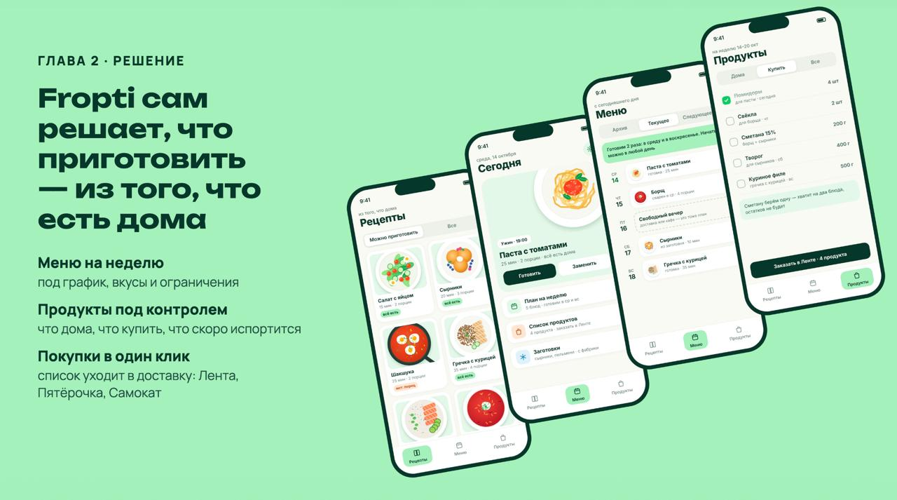
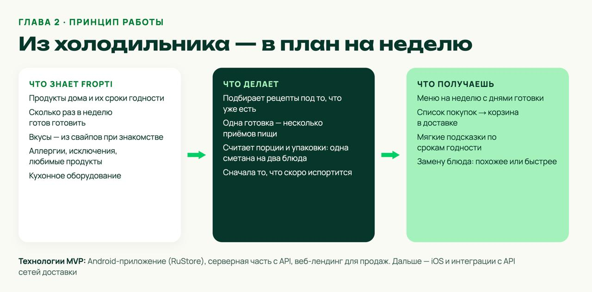

# Fropti · Video → Recipe

[](https://github.com/VictoriaPugach/recipe-video-extraction-pipeline/actions/workflows/ci.yml)

[](LICENSE)


Fropti помогает планировать домашнее питание: что приготовить, когда готовить и какие продукты купить. Модуль Video → Recipe превращает короткое видео в структурированный рецепт, который можно использовать в плане питания и списке покупок.






Это материалы питча и макеты целевого продукта, не список готовых интеграций. Описание файлов и правила добавления новых слайдов есть в [docs/slides](docs/slides/README.md).

## Задача модуля

Сервис принимает URL или загруженный файл, проверяет ограничение в 180 секунд, получает речь и текст с кадров, собирает JSON-рецепт и проверяет его по единому контракту. Python работает на сервере; мобильное приложение получает JSON по REST.

| В репозитории | Следующий этап |
| --- | --- |
| FastAPI, CLI, Docker, CI, тесты и обработка границ API | Безопасное получение видео и реальная проверка длительности |
| Общий пакет `fropti-core-contracts` 1.0.0 и JSON Schema | STT, выбор кадров, OCR, LLM и обработка ошибок |
| Синтетические JSON-примеры, рубрика, шаблон PR | Три разрешённых видео, эталоны и сквозные результаты |

## Быстрый старт

Нужны Git и Docker Compose. Для локального запуска: Python 3.10+.

```bash
git clone https://github.com/VictoriaPugach/recipe-video-extraction-pipeline.git
cd recipe-video-extraction-pipeline
cp .env.example .env
make install
make test
make run
```

Открыть [Swagger UI](http://localhost:8000/docs). Команда `make test` проверяет JSON Schema, API, CLI, загрузку файла и общий контракт без API-ключей и внешних моделей. Docker-вариант: `docker compose up --build`.

Подробные запросы, ответы и коды ошибок находятся в [API reference](docs/api_reference.md). Конфигурация и последовательность этапов находятся в [архитектуре](docs/architecture.md).

## Единый Recipe для трёх модулей

Источник истины: устанавливаемый пакет [`fropti-core-contracts`](packages/fropti-core-contracts/) версии `1.0.0` и его [JSON Schema](packages/fropti-core-contracts/schemas/recipe-1.0.0.schema.json). У всех рецептов одинаковые `schema_version`, `title`, `servings`, `ingredients`, `steps` и `source`.

```bash
.venv/bin/python -m fropti_core_contracts data/expected_outputs/*.json
```

| Модуль | Использование Recipe |
| --- | --- |
| Video extraction | Производит и валидирует рецепт |
| Cooking planner / batch cooking | Читает шаги и порции; граф и ресурсы задаёт собственный контракт |
| Shopping list | Читает ингредиенты и порции; остатки и агрегацию задаёт собственный контракт |

Контрактные тесты проверяют одинаковый JSON для всех трёх ролей. Правила полей, nullable-значений, единиц и версий описаны в [схеме данных](docs/data_schema.md).

## Объём MVP

Обязательный результат: локальный MP4 и URL одной согласованной платформы, ограничение длительности, STT, OCR, LLM, валидный `Recipe`, тесты без ключей и три реальных прогона с ручными эталонами.

Бонусы после MVP: дополнительные платформы, очередь, GPU-оптимизация, UI, база данных и публикация пакета. Полный пошаговый план находится в [src/TODO.md](src/TODO.md).

## Проверка и сдача

- `make test`: обязательная локальная проверка; CI запускает её на `push` и Pull Request.
- [docs/evaluation.md](docs/evaluation.md): измеримая рубрика, зоны ответственности и порог совпадения с эталоном ≥80%.
- [CONTRIBUTING.md](CONTRIBUTING.md): правила ревью Виктории Пугач и Любы Новохацкой.
- [PR template](.github/pull_request_template.md): команды проверки, JSON-примеры и демонстрационный ролик до четырёх минут.
- [SECURITY.md](SECURITY.md): как сообщать об уязвимостях; секреты, cookies и персональные данные в репозиторий не добавлять.

## Навигация

| Материал | Содержание |
| --- | --- |
| [Архитектура](docs/architecture.md) | Границы модулей и целевой pipeline |
| [Схема данных](docs/data_schema.md) | Recipe 1.0.0, JSON Schema и интеграция трёх команд |
| [API](docs/api_reference.md) | Эндпоинты и ошибки |
| [FAQ](docs/faq.md) | Практические вопросы реализации |
| [Данные](data/input_videos/README.md) и [примеры](data/expected_outputs/README.md) | Видео, права использования и JSON-эталоны |
| [CHANGELOG](CHANGELOG.md) | История изменений |

Лицензия кода: [MIT](LICENSE). Права на сторонние видео и изображения проверяются отдельно.
