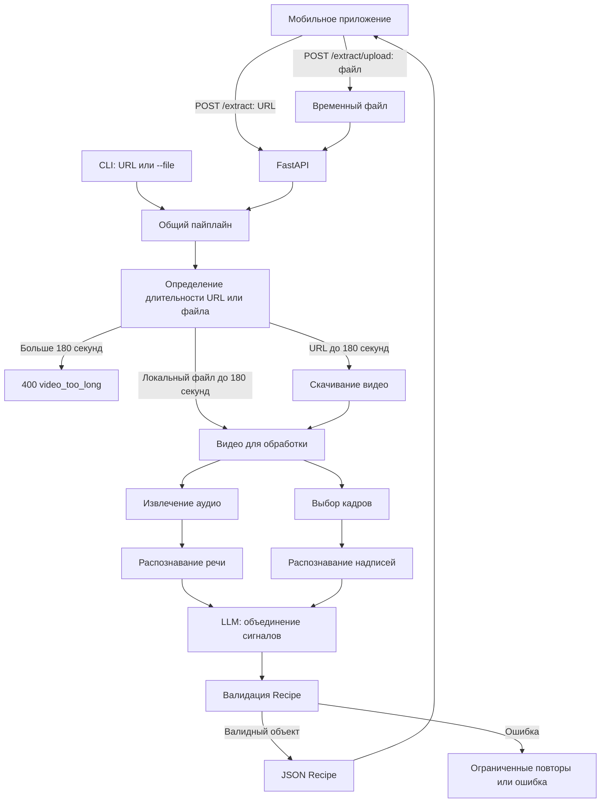

# Архитектура

## Граница сервиса

Модуль — серверный Python-сервис с FastAPI. Мобильный клиент отправляет URL через `POST /extract` или файл через `POST /extract/upload` и получает `Recipe`. Flutter или KMP еще не выбраны; это не меняет HTTP-контракт. Распознавание и тяжелые модели работают на сервере. Хранилище рецептов, недельное меню и доставка продуктов находятся за границами этого репозитория.

## Целевой пайплайн

Схема показывает целевое поведение. В каркасе рабочие API и CLI вызывают общий пайплайн, но скачивание, определение длительности, STT, OCR и LLM оставлены студенту. До их реализации API возвращает `501`.

API уже принимает непустой файл до 100 МиБ и сохраняет его в `TemporaryDirectory` под серверным именем. Папка удаляется после запроса, включая ошибки. `extract_recipe(source: str | Path)` и `probe_duration(source: str | Path)` принимают URL либо локальный путь. CLI с `--file` передает исходный локальный файл напрямую; скачивать его повторно не нужно.

## Ответственность модулей

| Файл | Ответственность |
| --- | --- |
| `src/api.py` | HTTP-запросы, схема ответа и преобразование ошибок |
| `src/main.py` | CLI поверх того же пайплайна |
| `src/config.py` | Конфигурация из окружения |
| `src/pipeline.py` | Порядок шагов и ограничение длительности |
| `src/downloader.py` | Длительность URL или локального файла; скачивание только для URL |
| `src/extractors/stt.py` | Аудио и распознавание речи |
| `src/extractors/frames.py` | Выбор кадров |
| `src/extractors/ocr.py` | Текст из кадров |
| `src/llm/fusion.py` | Сбор рецепта из распознанных сигналов |
| `src/models/` | Выбор общего или явно чернового контракта |

Планирование меню не должно появляться внутри `fusion.py`: его результат — рецепт, пригодный для других модулей Fropti.

## Контракт

Целевой источник `Recipe` — `fropti_core_contracts.models`. По умолчанию используется явно обозначенный режим `draft`, чтобы каркас можно было запустить без неопубликованной зависимости. Для интеграции нужен `shared` и согласованная версия пакета. Ошибка импорта общего пакета не должна приводить к скрытой подмене модели. См. [data_schema.md](data_schema.md).

## Эксплуатационные границы MVP

Синхронный API выбран для первого сквозного сценария. База данных и очередь не требуются каркасу. Если измеренное время обработки не укладывается в таймаут мобильного клиента, согласуй отдельный асинхронный контракт заданий до его реализации.

До включения реального скачивания нужны проверка адресов и редиректов против SSRF, ограничения объема, таймауты и очистка временных файлов. Проверка синтаксиса HTTP URL сама по себе не обеспечивает безопасность загрузчика. Метаданные длительности нужно проверять, а при недостоверных метаданных — ограничивать фактическую обработку файла.

`ffmpeg` нужен для обработки медиа. Конкретные STT/OCR/LLM, требования к CPU/GPU, ключи и стоимость вызовов определяются при реализации и фиксируются в документации. Docker каркаса не означает, что тяжелые модели уже настроены.
